<!-- HERO — the whole banner opens the portfolio -->

  
  
  

## 👨‍💻 About me

## 💼 Experience

<b>Products I've built — live in production</b>

   

<b>Read as text</b>

 

**Frontend Developer · IFAS EduTech Pvt. Ltd.** — *Present* · Pune, India
- Own the frontend of **4 live production platforms** used by **50,000+ learners** across India
- Build and scale **Next.js** applications with SSR / SSG — fast, SEO-friendly and production-ready
- Integrated **100+ REST APIs** end-to-end — authentication, courses, video streaming and payments
- Designed reusable **React + TypeScript** component libraries — ~30% faster UI delivery
- Optimised Webpack / Babel builds — leaner bundles and ~25% faster page loads
- Shipped an **admin CRM** with role-based access, real-time reports and student progress tracking

**Frontend Developer · e2eHiring** — *from Aug 2023* · Pune, India
- Started my professional journey shipping production React.js interfaces for EdTech products
- Delivered mobile-first responsive UI, worked in Agile sprints and mentored 2 junior developers

## 🚀 Featured work

  
  
  
  

  

## 🛠️ Tech stack

## 📈 GitHub activity

  

  <picture>
    <source media="(prefers-color-scheme: dark)" srcset="https://raw.githubusercontent.com/janmenjaya7/janmenjaya7/output/github-snake-dark.svg" />
    <source media="(prefers-color-scheme: light)" srcset="https://raw.githubusercontent.com/janmenjaya7/janmenjaya7/output/github-snake.svg" />
    
  </picture>
   
  Most of my production work lives in private company repositories — these cards show my public GitHub only.

## 🎓 Certifications &amp; recognition

## 🤝 Let's build something great

  
  
  

Crafted with care by <b>Janmenjaya Biswal</b> · Pune, India · 2026
