<div align="center">

<!-- HERO — the whole banner opens the portfolio -->
<a href="https://www.janmenjaya.in" target="_blank" title="Visit my portfolio">
  
</a>

<a href="https://www.janmenjaya.in" target="_blank">
  
</a>

<p>
  <a href="https://www.janmenjaya.in"></a>
  <a href="https://www.linkedin.com/in/janmenjaya-biswal-0ba83b212/"></a>
  <a href="mailto:janmenjayabiswal@gmail.com"></a>
</p>


</div>


## 👨‍💻 About me

<table>
<tr>
<td width="56%" valign="top">

```ts
const janmenjaya = {
  role     : "Frontend Developer",
  company  : "IFAS EduTech Pvt. Ltd.",   // current
  location : "Pune, India",

  focus: [
    "Reusable component architecture",
    "Performance & Core Web Vitals",
    "Mobile-first, accessible UI",
  ],

  impact: {
    learners : "50,000+",
    products : 4,          // live in production
    apis     : "100+",     // integrated end-to-end
    loadTime : "-25%",     // build optimisation
  },

  learning : ["System Design", "Web Performance"],
  offline  : ["📸 Photography", "✈️ Travel", "📚 Books"],
};
```

</td>
<td width="44%" valign="top">

**I build fast, polished web products that people actually enjoy using.**

For the last 3+ years I've been shipping the IFAS EduTech platform family — the learning portal, course marketplace, admin CRM and more — used by **50,000+ learners** preparing for competitive exams across India.

**What I care about**
- ⚛️ Clean, typed, reusable React code
- ⚡ Fast first loads and smooth interactions
- 📱 Pixel-perfect on every screen size
- 🤝 Mentoring and honest code reviews

**Highlights**
- 🏆 Excellence Award for project delivery
- 📦 ~30% faster UI work via shared component libraries
- 👥 Mentored 2 junior developers

</td>
</tr>
</table>


## 💼 Experience

<div align="center">


<p><b>Products I've built — live in production</b></p>
<p><a href="https://ifasonline.com"></a> <a href="https://crm.ifasonline.com"></a> <a href="https://lurnigo.com"></a> <a href="https://anjanasamaj.in"></a></p>

</div>

<details>
<summary><b>Read as text</b></summary>
<br/>

**Frontend Developer · IFAS EduTech Pvt. Ltd.** — *Present* · Pune, India
- Own the frontend of **4 live production platforms** used by **50,000+ learners** across India
- Build and scale **Next.js** applications with SSR / SSG — fast, SEO-friendly and production-ready
- Integrated **100+ REST APIs** end-to-end — authentication, courses, video streaming and payments
- Designed reusable **React + TypeScript** component libraries — ~30% faster UI delivery
- Optimised Webpack / Babel builds — leaner bundles and ~25% faster page loads
- Shipped an **admin CRM** with role-based access, real-time reports and student progress tracking

**Frontend Developer · e2eHiring** — *from Aug 2023* · Pune, India
- Started my professional journey shipping production React.js interfaces for EdTech products
- Delivered mobile-first responsive UI, worked in Agile sprints and mentored 2 junior developers

</details>


## 🚀 Featured work

<table>
<tr>
<td width="50%" valign="top">

### 🎓 [IFAS Online](https://ifasonline.com)
<sub>**EdTech learning portal** · 50,000+ learners · 🟢 Live</sub>

Course management, HD video streaming, quiz engine, progress tracking and payments.

  

</td>
<td width="50%" valign="top">

### 📊 [IFAS Admin CRM](https://crm.ifasonline.com)
<sub>**Internal dashboard** · role-based access · 🟢 Live</sub>

Real-time reporting, student progress tracking and admin management modules.

  

</td>
</tr>
<tr>
<td width="50%" valign="top">

### 🛒 [Lurnigo](https://lurnigo.com)
<sub>**Online course marketplace** · 🟢 Live</sub>

Instructor dashboards, enrollment, content delivery and progress analytics.

  

</td>
<td width="50%" valign="top">

### 🌐 [Anjana Samaj](https://anjanasamaj.in)
<sub>**Community portal** · 🟢 Live</sub>

Member portal, events management and announcement board.

  

</td>
</tr>
</table>

<div align="center">
  <a href="https://www.janmenjaya.in/#projects"></a>
</div>


## 🛠️ Tech stack

<div align="center">

<table>
<tr>
<td align="center" width="25%"><b>Frontend</b><br/><br/></td>
<td align="center" width="25%"><b>Styling &amp; UI</b><br/><br/></td>
<td align="center" width="25%"><b>Mobile &amp; Backend</b><br/><br/></td>
<td align="center" width="25%"><b>Tools &amp; Cloud</b><br/><br/></td>
</tr>
</table>

</div>


## 📈 GitHub activity

<div align="center">

<sub>Most of my production work lives in private company repositories — these cards show my public GitHub only.</sub>

<br/><br/>


<picture>
  <source media="(prefers-color-scheme: dark)" srcset="https://raw.githubusercontent.com/janmenjaya7/janmenjaya7/output/github-snake-dark.svg" />
  <source media="(prefers-color-scheme: light)" srcset="https://raw.githubusercontent.com/janmenjaya7/janmenjaya7/output/github-snake.svg" />
  
</picture>

</div>


## 🎓 Certifications &amp; recognition

<div align="center">

<table>
<tr>
<td align="center" width="25%">
<br/><br/>
<b>Excellence Award</b><br/>
<sub>IFAS EduTech Pvt. Ltd.</sub>
</td>
<td align="center" width="25%">
<br/><br/>
<b>Associate Cloud Engineer</b><br/>
<sub>Google Cloud · Jan 2023</sub>
</td>
<td align="center" width="25%">
<br/><br/>
<b>Master of Computer Applications</b><br/>
<sub>Trident Academy · 2019 – 2022</sub>
</td>
<td align="center" width="25%">
<br/><br/>
<b>Android App Development</b><br/>
<sub>Mobile Development · May 2020</sub>
</td>
</tr>
</table>

</div>


<div align="center">

## 🤝 Let's build something great

I'm open to **frontend roles, freelance projects and collaborations**.<br/>
If you have an idea, a product or a team that needs a React / Next.js developer — let's talk.

<p>
  <a href="https://www.janmenjaya.in/#contact"></a>
  <a href="https://www.linkedin.com/in/janmenjaya-biswal-0ba83b212/"></a>
  <a href="mailto:janmenjayabiswal@gmail.com"></a>
</p>


<sub>Crafted with care by <b>Janmenjaya Biswal</b> · Pune, India · 2026</sub>

</div>
